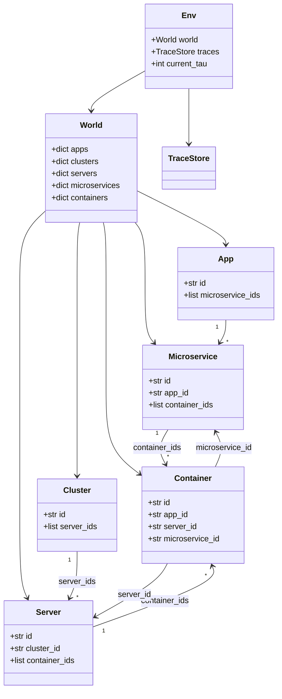

# Implementation Plan (v8)

Modular Python plan for the hierarchical edge autoscaling workbench.

**Two parts, kept separate**

| | Part A — Environment | Part B — Autoscaler |
|---|---|---|
| Job | Mimic clusters / apps / containers / load over time | Decide scaling; call env APIs |
| Works alone? | **Yes** (autoscaler off) | Needs Part A |
| Contains hierarchy? | No — only topology metadata | Yes — inside hierarchical plugin |

**v8 changes (bug-fix pass, §18):** closed the empty-microservice/app/cluster gap that could crash or silently swallow load in routing; fixed a real `ZeroDivisionError` in the μ_ram formula when `ram_per_request_mb == 0`; made the zero-headroom equal-share routing fallback an explicit formula; aligned the engine tick-loop pseudocode with the deterministic `sorted(...)` iteration mandated by the clock loop; fixed a stale reference-validation row left over from a pre-nesting config schema; added EPS tolerance to boundary validations for consistency with server packing; renamed a history field to match the doc's own λ notation.

**v7 changes (review pass):** locked trace CSV format; fixed section cross-refs; restored numeric worked examples; added golden expected outputs for `00-tiny.yaml`; clarified trace indexing; resolved validate-vs-load contradiction; added missing validation rules; documented `run_id`, `App`, and cluster↔server wiring; narrowed Part A write-API scope to types-only.

**Part A locks:**

1. **Capacity-weighted routing** among replicas (CPU serving headroom only — not configurable).  
2. **Drop overflow** (no cross-tick queue): excess requests are dropped and **logged**.  
3. **Serving capacity = resources above deployment minima** (`alloc − min`).  
4. **Per-MS max** (`cpu_max_cores`, `ram_max_mb`) caps vertical growth; server capacity is the physical ceiling.  
5. **Traces**: one CSV per microservice under `traces_dir`.  
6. **Config pre-check**: validate everything before building the world or running ticks.  
7. **Minimal config**: every YAML field is required for Part A; no optional policy/autoscaler keys yet.

**Naming:** all CPU quantities use a `_cores` suffix in config, code, and logs (e.g. `cpu_alloc_cores`). RAM quantities use `_mb`.

Related: [02-custom-simulator-environment.md](./02-custom-simulator-environment.md) · [01-implementation-evaluation-options.md](./01-implementation-evaluation-options.md) · [04-part-a-implementation-steps.md](./04-part-a-implementation-steps.md) (step-by-step build + review gates) · `../algorithm.tex`

---

## 1. Design lock (accept before coding)

| # | Decision | v1 choice |
|---|---|---|
| L1 | Trace time unit | One CSV **data row** = one **tick** `τ = 1…N`. Config `tick_sec` is metadata (seconds per tick); **row order** drives τ, not the `time_unit` column value alone. |
| L2 | Decision cadence | **Part B only.** Part A runs every tick; no autoscaler hook in v1 code path. |
| L3 | Resource model | `cpu_min_cores`/`ram_min_mb` = deploy footprint; serving uses headroom `alloc − min` (§4). |
| L4 | Per-tick capacity | Container fully available each tick (no backlog). |
| L5 | History + disk logs | In-memory per tick; flushed to per-container files (§8). |
| L6 | Routing | Capacity-weighted; weight ∝ **CPU serving headroom** `(cpu_alloc_cores − cpu_min_cores)` — **fixed, not configurable**. |
| L7 | Overflow | **Drop** excess this tick; log drops. No queue. **Not a config parameter.** |
| L8 | MS max | `cpu_max_cores`, `ram_max_mb` per microservice type; clamp vertical alloc (§4.1). |
| L9 | Float compares | `EPS = 1e-9` — **constant in code**, not config. |
| L10 | Scaling actions | Effective **next tick** — **constant in code** when Part B arrives. |
| L11 | Concurrency | No threads. |
| L12 | Stack | Plain Python; no Mesa / Docker / K8s in eval loop. |
| L13 | Config | Load → **validate (fail fast)** → build world (§3). |

**Deferred to Part B or later:** vicinities, BEG latency gate, tier/borrower loans, live `spawn`/`resize`/`terminate`, autoscaler policy knobs, queue overflow modes, alternative cost-model authoring.

---

# Part A — Environment

## 2. Time model

### 2.1 Tick clock (Part A)

| Clock | Meaning |
|---|---|
| **Tick** `τ = 1, 2, …, N` | Finest sim step; one trace data row per microservice |

`N` = number of **data rows** in each per-MS trace file (all MS traces must agree — checked at validate time).

```text
for τ in 1..N:                                        # outer: time
    for ms in sorted(microservices, key=lambda m: m.id):  # inner: per microservice, id order
        Λ ← traces.get(ms.id, τ)                      # 1-based τ; see §6
        apply_microservice_load(τ, ms, Λ)
    flush_container_logs(τ)
```

MS processing order has no effect on any container's numbers in Part A — each MS's containers are independent (no shared mutable state; server capacity is only checked statically at validate time). The `sorted(..., key=...)` is here purely so iteration order is a pure function of `ms.id`, not of dict/insertion order, which keeps the A7 determinism test's rationale explicit rather than accidental. §16.4 uses the same order.

**Part A must work with autoscaler off:** after a run, plot each container’s usage from **object-local history** and from on-disk CSVs.

### 2.2 Per-tick apply (locked)

```text
def apply_microservice_load(τ, ms, Λ):
    containers ← live containers of ms        # ms.container_ids
    weights ← capacity_weights(containers)    # §4.3
    for c in containers:
        λ_in ← weights[c] * Λ
        μ ← serving_capacity(c, ms.spec)      # §4.2
        λ_served ← min(λ_in, μ)
        λ_dropped ← λ_in − λ_served           # DROP; log
        update usage from λ_served            # §4.2
        c.append_history(τ, ...)
```

**Single-replica shortcut:** when `len(containers) == 1`, routing assigns all Λ to that container (`w = 1.0`).

---

## 3. Config load and pre-check

### 3.1 Pipeline (fail fast)

```text
load_yaml(path) → RawConfig
validate(config) → list[ValidationError]     # reads trace files (row count + values)
validate_or_raise(config) → WorldSpec        # validate + convert; raises ConfigError
load_traces(world_spec) → TraceStore         # full trace load (after validate)
build_world(world_spec) → World
Env(world, traces) → run()
```

**Before `validate` passes:** no `World` build, no `TraceStore` load, no results directory creation, no tick loop.

**Trace I/O at validate time:** validator **may read** trace CSVs to check existence, equal row counts, header, non-negative values, and `time_unit` sequence — but does **not** populate `TraceStore` until validation succeeds.

### 3.2 Validation rules

| Rule | Error if violated |
|---|---|
| Unique IDs | Duplicate `cluster`, `server`, `app`, `microservice`, or `container` id |
| Non-empty world | ≥ 1 cluster, ≥ 1 server, ≥ 1 app, ≥ 1 microservice, ≥ 1 container (global counts) |
| MS coverage | Every `microservice` has ≥ 1 container — **required**: an MS with zero containers has no valid routing target and would divide-by-zero in the equal-share fallback (§4.3) |
| App coverage | Every `app` has ≥ 1 microservice |
| Cluster coverage | Every `cluster` has ≥ 1 server |
| References | Every `container.server_id` exists among declared servers. (A container's app/microservice ownership comes from its position in the YAML nesting — apps → microservices → containers — so it never needs a separate cross-reference check.) |
| Cluster membership | Every `server_id` referenced by a container belongs to a server listed under some cluster |
| Server caps | `cpu_cap_cores > 0`, `ram_cap_mb > 0` |
| MS coeffs | `cpu_min_cores > 0`, `cpu_max_cores ≥ cpu_min_cores`, `ram_min_mb > 0`, `ram_max_mb ≥ ram_min_mb`, `cpu_per_request_cores > 0`, `ram_per_request_mb ≥ 0` |
| Container alloc | `cpu_min_cores ≤ cpu_alloc_cores ≤ cpu_max_cores`, `ram_min_mb ≤ ram_alloc_mb ≤ ram_max_mb` |
| Server packing | Sum of `cpu_alloc_cores` on a server ≤ `cpu_cap_cores + EPS`; same for RAM |
| Traces dir | `traces_dir` exists and is a directory |
| Trace files | Each MS `trace_file` exists under `traces_dir` |
| Trace length | All MS trace CSVs have the **same data row count** `N ≥ 1` |
| Trace header | Exactly `time_unit,requests` (locked) |
| Trace `time_unit` | Data rows have `time_unit == 1, 2, …, N` in order (validates row/sync integrity) |
| Trace values | `requests ≥ 0` for all rows |
| Sim | `tick_sec > 0`, `results_dir` non-empty string, `seed` is int |
| Reference topology | Tests use **1 cluster, 2 servers, 1 app, 1 MS, 1 container**; validator accepts general case |

**Float tolerance:** every boundary comparison in this table (`Container alloc`, `Server caps`, `Server packing`, `MS coeffs`) uses the same `EPS` (L9) slack as the packing rule, e.g. `cpu_min_cores − EPS ≤ cpu_alloc_cores ≤ cpu_max_cores + EPS`. One rule, applied uniformly — avoids false rejects from float representation without special-casing any single row.

### 3.3 Validation API

```python
# env/validate.py
@dataclass
class ValidationError:
    path: str      # e.g. "apps[0].microservices[0].containers[0].cpu_alloc_cores"
    message: str

class ConfigError(Exception):
    errors: list[ValidationError]

def validate(config: RawConfig) -> list[ValidationError]: ...

def validate_or_raise(config: RawConfig) -> WorldSpec:
    errs = validate(config)
    if errs:
        raise ConfigError(errs)
    return to_world_spec(config)
```

Unit tests: **one test per reject rule** with a minimal broken YAML (or trace) fixture.

---

## 4. Request → resource model

### 4.1 Microservice spec (per type)

| Parameter | Meaning |
|---|---|
| `cpu_min_cores` | Minimum CPU cores (deploy footprint / floor) |
| `cpu_max_cores` | Maximum CPU cores per container (vertical cap) |
| `ram_min_mb` | Minimum RAM (MB) |
| `ram_max_mb` | Maximum RAM (MB) per container |
| `cpu_per_request_cores` | CPU cores to process one request in one tick |
| `ram_per_request_mb` | Extra RAM (MB) per request in that tick |
| `trace_file` | Filename under `traces_dir` |

**Deployment floor** (`cpu_min_cores`, `ram_min_mb`) must be allocated to run; it does **not** buy throughput.

**Serving headroom:** `cpu_serve_cores = cpu_alloc_cores − cpu_min_cores`, `ram_serve_mb = ram_alloc_mb − ram_min_mb`. Only headroom buys μ.

**Effective alloc ceiling** (Part B resize; documented now):

```text
cpu_alloc_cores ≤ min(cpu_max_cores, server_free_cpu_cores + cpu_alloc_cores_self)
ram_alloc_mb    ≤ min(ram_max_mb, server_free_ram_mb + ram_alloc_mb_self)
```

### 4.2 Per-container formulas (locked)

```text
cpu_serve_cores = max(0, cpu_alloc_cores - cpu_min_cores)
ram_serve_mb    = max(0, ram_alloc_mb - ram_min_mb)

μ_cpu = cpu_serve_cores / cpu_per_request_cores           # cpu_per_request_cores > 0 always (validated)
μ_ram = ram_serve_mb / ram_per_request_mb if ram_per_request_mb > EPS else INF
μ = min(μ_cpu, μ_ram)

λ_served = min(λ_in, μ)
λ_dropped = λ_in - λ_served

cpu_used_cores = min(cpu_alloc_cores, cpu_min_cores + λ_served * cpu_per_request_cores)
ram_used_mb    = min(ram_alloc_mb, ram_min_mb + λ_served * ram_per_request_mb)
```

**Implementation note:** `ram_per_request_mb == 0` is a valid config (§3.2 allows `≥ 0`), so `μ_ram` **must** be special-cased to `INF` rather than computed as a literal `x / 0.0` — Python raises `ZeroDivisionError` on float division by zero, it does not return `inf`. `cpu_per_request_cores` has no such guard because validation requires it `> 0`.

**Fresh-tick rule:** no backlog; next tick ignores prior drops.

**Utilization** (computed every tick; used by Part B later):

```text
q_cpu = (λ_served * cpu_per_request_cores) / max(cpu_serve_cores, EPS)   # 0 if no headroom
q_ram = (λ_served * ram_per_request_mb) / max(ram_serve_mb, EPS)
```

### 4.3 Capacity-weighted routing (locked)

```text
h_i = max(0, cpu_alloc_cores_i - cpu_min_cores)
H   = sum(h)
w_i = h_i / H  if H > EPS  else  1 / len(containers)   # zero-headroom fallback: equal share
λ_in_i = w_i * Λ
```

Zero-headroom fallback only matters for bookkeeping: if every container's `h_i` is 0, every `μ_i` is also 0 (§4.2), so `λ_served_i = 0` and the full share is dropped regardless of how it was split. `len(containers) ≥ 1` is guaranteed by the **MS coverage** validation rule (§3.2), so this never divides by zero.

```python
# env/routing.py
def distribute(Λ: float, containers: list[Container], cpu_min_cores: float) -> dict[str, float]:
    ...
```

### 4.4 Worked examples (golden numbers for tests)

**A — Single container (`00-tiny.yaml`, tick 4):**

- `cpu_min_cores=0.5`, `cpu_alloc_cores=1.0` → `cpu_serve_cores=0.5` → `μ=0.5/0.01=50` req/tick  
- `ram` not binding at these loads  
- Λ=120 → `λ_served=50`, `λ_dropped=70`  
- `cpu_used_cores = 0.5 + 50×0.01 = 1.0`

**B — Two heterogeneous replicas (unit test `test_routing_and_drop_heterogeneous`):**

- MS `api`: `cpu_min_cores=0.5`, `cpu_per_request_cores=0.01`  
- Container A: `cpu_alloc_cores=1.0` → μ=50; Container B: `cpu_alloc_cores=3.0` → μ=250  
- Λ=400 → A gets 66.7, serves 50, drops 16.7; B gets 333.3, serves 250, drops 83.3

---

## 5. Overflow (locked: drop only)

Excess requests beyond μ are **dropped and logged**. No queue, no backlog field on `Container`.

Queue-based models are **future ablation only**.

---

## 6. Traces

### 6.1 Layout

```text
traces/
└── demo/                    # traces_dir in config
    └── api.csv              # one file per microservice
```

### 6.2 CSV format (locked)

```csv
time_unit,requests
1,0
2,10
3,45
```

- Header must be exactly `time_unit,requests`.  
- Data row `k` (1-based) = tick `τ = k`; `time_unit` column must equal `k` (validator enforces).  
- `requests` = Λ for that MS at that tick (≥ 0).  
- All MS files must have the same number of data rows `N`.

### 6.3 TraceStore indexing

```python
# env/traces.py
class TraceStore:
    def get(self, ms_id: str, tau: int) -> float:  # tau is 1-based
        return self._data[ms_id][tau - 1]
```

Internal storage: `dict[str, list[float]]` indexed `0…N−1`; public API is **1-based τ** to match the engine and log files.

---

## 7. In-memory history

```python
@dataclass
class ContainerTickRecord:
    tau: int
    lambda_in: float            # per-container arrival after routing (§4.3); NOT the MS-level Λ
    lambda_served: float
    lambda_dropped: float
    cpu_usage_cores: float
    ram_usage_mb: float
    cpu_alloc_cores: float
    ram_alloc_mb: float
    q_cpu: float               # stored for later autoscaler / plots
    q_ram: float
```

- Store **full run** in memory for v1 (N ticks).  
- API: `container.history`, `container.history_at(tau)`.

Per-tick aggregates on `Server` and `Microservice` (total Λ, drops, max q) updated each tick.

---

## 8. On-disk outputs

### 8.1 Run id and folder layout

```text
run_id = f"{seed}_{utc_timestamp}"     # e.g. 42_20260806T081500Z
results/<run_id>/
├── run_meta.yaml              # config snapshot + N + seed + run_id
├── apps/
│   └── demo_app/
│       └── api/
│           ├── c-api-1.meta.json
│           └── c-api-1.log.csv
└── summary.csv                # optional (Part A nice-to-have)
```

### 8.2 Container metadata (`*.meta.json`)

Written once at run start from config + placement (not updated in Part A):

```json
{
  "container_id": "c-api-1",
  "app_id": "demo_app",
  "microservice_id": "api",
  "server_id": "c1-w1",
  "cluster_id": "c1",
  "cpu_min_cores": 0.5,
  "cpu_max_cores": 4.0,
  "ram_min_mb": 256,
  "ram_max_mb": 4096,
  "cpu_per_request_cores": 0.01,
  "ram_per_request_mb": 0.5,
  "initial_cpu_alloc_cores": 1.0,
  "initial_ram_alloc_mb": 512
}
```

### 8.3 Per-tick log (`*.log.csv`)

| Column | Internal field |
|---|---|
| `time_unit` | τ |
| `cpu_core_capacity` | `cpu_alloc_cores` |
| `ram_size_capacity_mb` | `ram_alloc_mb` |
| `cpu_core_used` | `cpu_used_cores` |
| `ram_size_used_mb` | `ram_used_mb` |
| `incoming_requests` | `λ_in` |
| `served_requests` | `λ_served` |
| `dropped_requests` | `λ_dropped` |

Log column names stay human-readable; Python fields use `_cores` / `_mb`.

---

## 9. EnvAPI (Part A scope)

### Read
`get_time()`, `list_apps()`, `list_clusters()`, `list_servers()`, `list_microservices()`, `list_containers()`, `get_ms_spec()`, `get_container()`, `get_server_free()`, history accessors.

### Write (Part A: types only; implementation in Part B)
Define `RejectReason` enum and method signatures for `spawn` / `resize` / `terminate` — **no live calls in Part A run**. Unit tests for write validation start in Part B.

### Run
`Env.from_config(path)` or `run(config_path)` — load, validate, build world, load traces, execute tick loop, flush logs.

---

## 10. Package layout (Part A)

```text
hass/
├── configs/00-tiny.yaml
├── traces/demo/api.csv
├── examples/run_env_only.py
├── tests/
│   ├── fixtures/              # broken YAML + trace snippets per reject rule
│   ├── test_validate.py
│   ├── test_routing.py
│   ├── test_usage.py
│   ├── test_traces.py
│   ├── test_world.py
│   └── test_engine.py
└── src/hass/env/
    ├── config.py
    ├── validate.py
    ├── world.py
    ├── models.py
    ├── traces.py
    ├── routing.py
    ├── usage.py
    ├── engine.py
    ├── metrics_log.py
    └── api.py
```

---

## 11. Config sketch (complete — Part A reference)

```yaml
# configs/00-tiny.yaml

sim:
  tick_sec: 1.0
  results_dir: results/
  seed: 42

traces_dir: traces/demo/

topology:
  clusters:
    - id: c1
      servers:
        - id: c1-w1
          cpu_cap_cores: 8.0
          ram_cap_mb: 16384
        - id: c1-w2
          cpu_cap_cores: 8.0
          ram_cap_mb: 16384

apps:
  - id: demo_app
    microservices:
      - id: api
        cpu_min_cores: 0.5
        cpu_max_cores: 4.0
        ram_min_mb: 256
        ram_max_mb: 4096
        cpu_per_request_cores: 0.01
        ram_per_request_mb: 0.5
        trace_file: api.csv
        containers:
          - id: c-api-1
            server_id: c1-w1
            cpu_alloc_cores: 1.0
            ram_alloc_mb: 512
```

**Matching trace** (`traces/demo/api.csv`):

```csv
time_unit,requests
1,0
2,25
3,80
4,120
5,50
```

### 11.1 Golden expected outputs (`c-api-1`)

μ = 50 req/tick (§4.4 A). All Λ routed to the single container.

| τ | Λ | λ_served | λ_dropped | cpu_used_cores |
|---|---|---|---|---|
| 1 | 0 | 0 | 0 | 0.5 |
| 2 | 25 | 25 | 0 | 0.75 |
| 3 | 80 | 50 | 30 | 1.0 |
| 4 | 120 | 50 | 70 | 1.0 |
| 5 | 50 | 50 | 0 | 1.0 |

Use this table as the authoritative integration-test oracle for A5/A7.

**Validator sanity:** `c-api-1` on `c1-w1` uses 1.0 / 512 of 8.0 cores / 16384 MB; `c1-w2` empty.

**Removed from Part A config:** `overflow_mode`, `routing_weight`, `action_effective`, `history_maxlen`, `eps`, `decision_every_k_ticks`, `policy` / `theta_*`, `cost_model` reference batch, `default_cluster` / `default_ms`.

---

## 12. Part A milestones and tests

| ID | Deliverable | Tests |
|---|---|---|
| **A0** | Package scaffold, pytest, `pip install -e .` | `test_import_hass` |
| **A1** | `config.py` + `validate.py` | one test per §3.2 rule; golden pass on `00-tiny.yaml` |
| **A2** | `world.py` | 1 cluster, 2 servers, 1 container; `server.container_ids`; free capacity |
| **A3** | `traces.py` | row count, `time_unit` sequence, mismatch reject |
| **A4** | `routing.py` + `usage.py` | §4.4 A + B numeric cases |
| **A5** | `engine.py` | full 5-tick run matches §11.1 golden table |
| **A6** | `metrics_log.py` + `run_env_only.py` | disk tree §8; CSV columns; meta.json |
| **A7** | Determinism | two runs, same seed → identical log CSVs |

**Exit criterion:** `pytest` green; `python examples/run_env_only.py configs/00-tiny.yaml` produces logs matching §11.1.

---

## 13. Part B — Autoscaler (outline only)

- Implement `spawn` / `resize` / `terminate` with §4.1 ceilings.  
- `resource_need(Λ̂*)` from §4 headroom + `cpu_max_cores` clamp → horizontal when vertical exhausted.  
- Config gains `decision_every_k_ticks`, policy thresholds.  
- Vicinities, loans, tier/borrower — later.

---

## 14. Must-verify before coding (Part A)

- [ ] Complete config sketch + golden table (§11) accepted  
- [ ] Pre-check rules (§3.2) accepted  
- [ ] Per-MS traces + TraceStore indexing (§6) accepted  
- [ ] Drop-only overflow accepted  
- [ ] `cpu_*_cores` naming accepted  
- [ ] Object model (§16) accepted  
- [ ] Part A milestones (§12) accepted  

---

## 15. One-page picture

```text
load 00-tiny.yaml → validate (incl. trace files) → build world → load traces
        │
        ▼
for τ in 1..N:
  for ms in microservices:
      Λ ← traces.get(ms.id, τ)
      route by (cpu_alloc_cores - cpu_min_cores)
      serve min(λ_in, μ); DROP rest; append history
  flush logs → results/<run_id>/...
```

---

## 16. Object model — classes and relationships

### 16.1 Class inventory

| Class | Module | Role |
|---|---|---|
| `RawConfig` | `config.py` | Parsed YAML (unvalidated) |
| `WorldSpec` | `config.py` | Validated spec for build + trace load |
| `ValidationError` / `ConfigError` | `validate.py` | Pre-check failures |
| `SimConfig` | `config.py` | `tick_sec`, `results_dir`, `seed` |
| `ClusterSpec` / `ServerSpec` | `config.py` | Static topology |
| `AppSpec` / `MicroserviceSpec` / `ContainerSpec` | `config.py` | Static app model + initial placement |
| `World` | `world.py` | Runtime registry of all objects |
| `Env` | `api.py` | Facade: tick loop, queries |
| `App` | `models.py` | Groups microservices |
| `Cluster` | `models.py` | Groups edge servers |
| `Server` | `models.py` | Edge server: capacity + hosted containers |
| `Microservice` | `models.py` | Logical MS: spec + replica list |
| `Container` | `models.py` | Runnable unit: alloc, usage, history |
| `ContainerTickRecord` | `models.py` | One tick of metrics |
| `TraceStore` | `traces.py` | Per-MS request traces |

### 16.2 Relationship diagram



### 16.3 Index pattern (same for cluster, server, microservice)

Every parent↔child link uses **list on parent + id on child**:

| Parent | Parent index | Child back-pointer |
|---|---|---|
| `Cluster` | `server_ids` | `Server.cluster_id` |
| `Server` | `container_ids` | `Container.server_id` |
| `App` | `microservice_ids` | `Microservice.app_id` |
| `Microservice` | `container_ids` | `Container.microservice_id` |

`build_world()` registers each object in `World.*` dicts **and** appends to parent lists:

```python
def place_container(world, server, app, ms, spec) -> Container:
    c = Container(
        id=spec.id,
        app_id=app.id,
        server_id=server.id,
        microservice_id=ms.id,
        cpu_alloc_cores=spec.cpu_alloc_cores,
        ram_alloc_mb=spec.ram_alloc_mb,
    )
    world.containers[c.id] = c
    server.container_ids.append(c.id)
    ms.container_ids.append(c.id)
    return c
```

### 16.4 Tick loop

```text
Engine.tick(world, traces, τ):
  for ms in sorted(world.microservices.values(), key=lambda m: m.id):   # match §2.1
      containers = [world.containers[cid] for cid in ms.container_ids]
      Λ = traces.get(ms.id, τ)
      shares = routing.distribute(Λ, containers, ms.spec.cpu_min_cores)
      for c in containers:
          usage.apply(c, shares[c.id], ms.spec)
  metrics_log.flush(world, τ)
```

---

## 17. Review log (v6 → v7)

| # | Finding | Resolution |
|---|---|---|
| R1 | §2.2 pointed to §4.4 for routing (wrong section) | Fixed → §4.3 |
| R2 | Trace header ambiguous (`tick,requests` alternative) | Locked to `time_unit,requests` only |
| R3 | Contradiction: validate reads traces vs “no trace read” | Clarified: validate reads for checks; `TraceStore` loads after pass |
| R4 | §4.4 deferred to unit test without inline numbers | Restored golden examples + §11.1 table |
| R5 | Missing `time_unit` sequence validation | Added §3.2 rule |
| R6 | Trace indexing 0-based vs 1-based unclear | §6.3: internal 0-based, API 1-based |
| R7 | Write APIs “implement now” vs Part A scope | Part A: signatures + `RejectReason` only |
| R8 | No `App` in object model | Added `App` / `AppSpec` + `World.apps` |
| R9 | Cluster↔server wiring undocumented | §16.3 index table |
| R10 | `run_id` format unspecified | §8.1 |
| R11 | A5 “drops on tick 3–4” without oracle | §11.1 golden table |
| R12 | `ContainerTickRecord` missing q_cpu/q_ram | Added (computed every tick) |
| R13 | Missing `test_world.py`, `fixtures/` | Added to §10 |
| R14 | `seed` type not validated | Added §3.2 rule |

---

## 18. Review log (v7 → v8)

| # | Finding | Resolution |
|---|---|---|
| R15 | A microservice with zero containers passes all §3.2 rules (only *global* container count was checked), but `distribute()`'s equal-share fallback divides by `len(containers)` — crashes, or silently drops Λ with nothing to log against | Added **MS coverage** rule: every microservice needs ≥ 1 container. Added matching **App coverage** / **Cluster coverage** rules for the same class of orphaned-entity gap |
| R16 | §4.2's `μ_ram = ram_serve_mb / ram_per_request_mb` is a literal divide-by-zero in code whenever `ram_per_request_mb == 0` — which §3.2 explicitly allows (`≥ 0`). Python raises `ZeroDivisionError`; it does not silently produce `inf` the way the old comment implied | Formula now branches explicitly on `ram_per_request_mb > EPS`; added an implementation note calling out the Python gotcha |
| R17 | §4.3's "else equal share" fallback (when `sum(h) == 0`) was prose, not a formula, and used an exact `> 0` float comparison instead of `EPS` (inconsistent with L9) | Spelled out `w_i = 1 / len(containers)` explicitly; comparison now uses `EPS`; noted why it never divides by zero (ties to R15) |
| R18 | §16.4's tick loop iterated `world.microservices.values()` (dict/insertion order) while §2.1's clock loop mandated `sorted(microservices)` (no key given) — a latent inconsistency that only widens if we ever reorder dict construction | §2.1 now gives an explicit `key=lambda m: m.id`; §16.4 mirrors it exactly, so iteration order is a pure function of `ms.id` rather than build order |
| R19 | The **References** validation row said "container's MS is under declared app," but Part A's locked YAML nests `containers` under `microservices` under `apps` (§11) — there is no separate `app_id`/`ms_id` field on a container to cross-reference, so the rule described a check that cannot fail and doesn't match the schema | Reworded to describe only the real check (`server_id` existence) and note that app/MS ownership is structural, not a validated field |
| R20 | Only **Server packing** used an `EPS` slack; other boundary checks (`Container alloc`, `MS coeffs`, `Server caps`) compared floats exactly, an inconsistency with L9's "EPS everywhere" intent | Added one blanket "float tolerance" note applying `EPS` to every boundary comparison in §3.2, instead of special-casing one row |
| R21 | `ContainerTickRecord.lambda_arrival` used a name not found anywhere else in the doc, which otherwise consistently calls the per-container post-routing arrival `λ_in` (§4.2, §4.3, §8.3) | Renamed field to `lambda_in` with a clarifying comment distinguishing it from MS-level `Λ` |
