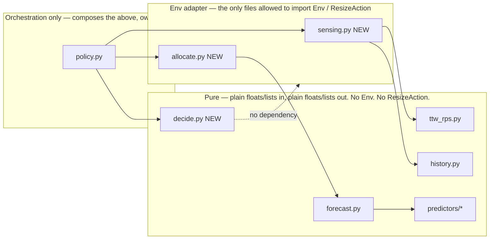

# Autoscaler File Structure, Naming, and Modularity — Review & Recommendations

**Audience:** design review, before Decide/Apply lands.
**Scope:** answers three concerns raised about `autoscaler/proactive_auto_scaler/` (and, for naming, the wider `env/` package).
**Related:** [proactive-decide-and-apply-plan.md](./proactive-decide-and-apply-plan.md) (already-agreed build plan for Decide/Apply — this doc extends it, does not replace it), [rps-forecast-predict-and-decide.md](./rps-forecast-predict-and-decide.md) (the math/symbol source of truth).

---

## 1) Why this file structure, and can we do better?

### 1.1 What exists today and why

```text
autoscaler/
  common/                      # cross-cutting, shared by every scaler
    actions.py                 # re-exports env action types (ResizeAction, ...)
    load.py                    # YAML -> scaler instance, by autoscaler.name
    params_base.py             # AutoscalerWrapper (enabled/name/params/decision_every_k_ticks)
    supported.py               # SUPPORTED_AUTOSCALERS registry
  reactive_vertical/           # one pluggable strategy
    policy.py                  # ReactiveVerticalAutoscaler (on_tick_end/on_actions_applied) + private helpers
    distribute.py               # ReplicaView + distribute_up/distribute_down
    params.py
  proactive_auto_scaler/        # another pluggable strategy
    policy.py                  # ProactiveAutoScaler (on_tick_end/on_actions_applied)
    params.py
    ttw_rps.py                 # counts -> RPS conversion, TTW-close detection
    history.py                 # RpsHistory ring buffer
    forecast.py                # recursive multi-horizon roll
    predictors/
      base.py                  # OneStepRpsPredictor protocol
      lstm_torch.py             # concrete LSTM predictor
```

The intent (visible in the code, not just inferred):

1. **`env/` never imports from `autoscaler/`.** `Env` only calls a duck-typed protocol (`on_tick_end(env, tau) -> list[Any]`, optional `on_actions_applied(results)` — see `_invoke_autoscaler` in `env/api.py`). Any object satisfying that protocol is a valid "autoscaler." This is already a **ports-and-adapters** boundary: `env/` is the port, each `autoscaler/<name>/` package is an adapter/plugin. That part is solid and should not change.
2. **One top-level package per selectable strategy**, named after the YAML `autoscaler.name` value (`reactive_vertical`, `proactive_auto_scaler`). `common/load.py` + `common/supported.py` do name → builder dispatch. Adding a third strategy means adding a third folder and one `if` branch — low ceremony, which matters for a research codebase that will grow strategies over time.
3. **`common/` holds only things every strategy needs** (action re-exports, YAML wrapper, registry) — not algorithm code. That's the right cut: it stays small and never becomes a dumping ground.
4. **Inside `proactive_auto_scaler/`**, the split so far is *by concept* (`ttw_rps.py`, `history.py`, `forecast.py`, `predictors/`), which is good, **except** `policy.py` still does three different jobs itself (see §3). That's the actual gap — not the top-level layout.

### 1.2 Can we do better? Yes — but at the *sub-package* level, not the top level

The top-level three-way split (`common/` + one folder per strategy) is a reasonable, low-overhead pattern for "a handful of swappable full-scaler strategies," and it already matches how `common/load.py` selects by name. **I would keep it.** Reorganizing to something like a single flat `autoscaler/` with all algorithms mixed together, or a plugin-registry-with-entry-points setup, would add ceremony without solving your actual pain point.

What *is* worth improving is the **internal shape of each strategy package** as it grows past "one policy file." Today `reactive_vertical/` already shows the failure mode: `policy.py` contains the class *and* `_aggregate_ms` (sensing) *and* `_intent_to_actions` (decide) *and* calls into `distribute.py` (allocate) — three concerns, one file, with private (`_`-prefixed) helpers that can't be unit-tested or reused independently. `proactive_auto_scaler/policy.py` is about to gain the same problem once Decide + Allocate land (§3 covers the concrete fix).

**Recommendation:** keep the top-level layout; treat each strategy package as its own small "sense → decide → allocate → orchestrate" pipeline, with one file (or a couple of pure functions) per stage. §3 gives the concrete target shape for `proactive_auto_scaler/` — it is a small, additive delta on top of what `proactive-decide-and-apply-plan.md` already proposes, not a rewrite.

---

## 2) Variable naming — is there a standard, and better names?

### 2.1 Is there a standard?

Broadly **PEP 8** (snake_case, typed dataclasses, docstrings) — that part is consistent everywhere. But there is a second, *unofficial* convention layered on top: many identifiers are **lifted verbatim from the math symbols in the design docs** (`rps-forecast-predict-and-decide.md`, `proposed_method_complete.tex`) — `L`, `W`/`feature_window`, `H`/`horizon_H`, `C`/`cooldown_C`, `θ`→`theta_*`, `α`→`alpha_*`, `δ`→`delta_*`, `Λ`→`lambda_in`, `r_t`, `r_hat`. That's a deliberate traceability choice (paper symbol ↔ code identifier), and it's *why* you're seeing single letters where PEP 8 would normally say "spell it out." It is not random — but it is applied a little inconsistently, and PEP 8 traceability doesn't require single-letter **local temporaries** inside a function body (that part is just habit bleeding over from the symbols).

So: two overlapping conventions, and the friction you're feeling is real. Below is where I'd keep the math-symbol style (it's earning its keep) vs. where I'd spell things out (it's just a scratch variable that doesn't appear anywhere else).

### 2.2 Concrete renames — `on_tick_end` in `proactive_auto_scaler/policy.py`

Current code (`src/hierarchical_edge_sim/autoscaler/proactive_auto_scaler/policy.py`, lines 40–99), trimmed to the parts being renamed:

```python
    def on_tick_end(self, env: Env, tau: int) -> list[Any]:
        tick_sec = float(env.world_spec.sim.tick_sec)
        L = self.params.ttw_ticks
        ...
        t = ttw_index(tau, L)
        for ms_id in env.list_microservices():
            n = self._bucket_n.get(ms_id, 0.0)
            ...
            r_t = counts_to_rps(n, ttw_ticks=L, tick_sec=tick_sec)
            hist = self._histories.setdefault(ms_id, RpsHistory(self.params.feature_window))
            ...
            if hist.is_full():
                features = hist.as_list()
                ...
                preds = forecast_horizon(features, self.params.horizon_H, self._predictor, ...)
                for h, r_hat in enumerate(preds, start=1):
                    ...
```

| Current | Scope | Keep, rename, or drop? | Suggested name | Why |
| --- | --- | --- | --- | --- |
| `L = self.params.ttw_ticks` | local alias, whole method | **Drop the alias** | use `self.params.ttw_ticks` directly | `L` only saves a few characters at 3 call sites; the alias forces the reader to hold "`L` = ttw_ticks" in their head. If line length is the real reason, rename to `ttw_len` instead of a bare letter. |
| `t = ttw_index(tau, L)` | local, whole method | **Rename** | `ttw_t` (or `ttw_idx`) | Bare `t` collides with the very common "temp/tuple" convention elsewhere in Python and isn't searchable (`grep -w t` is useless). `ttw_t` keeps the paper symbol *and* is greppable/self-describing. |
| `n = self._bucket_n.get(ms_id, 0.0)` | local, inner loop | **Rename** | `ttw_request_count` | This is literally \(N_t\) from the design doc §2.2 — name it that in English, keep `n_requests` (already used in `ttw_rps.counts_to_rps`) as the precedent. |
| `self._bucket_n` (field) | instance state | **Rename** | `self._ttw_request_totals` | "`bucket_n`" mixes a vague metaphor ("bucket") with a bare math letter (`n`); the field is a per-MS running sum of `lambda_in` *within the current, still-open TTW*. Name it what it durably is. |
| `hist = self._histories.setdefault(...)` | local, inner loop | **Rename** | `rps_history` | The class is literally `RpsHistory`; `hist` is an unnecessary abbreviation that also visually clashes with the unrelated `history_len` two lines later and the module name `history.py`. |
| `history_len` | local, inner loop | **Keep**, or drop | `rps_history_len` (or just inline `len(rps_history)` at both use sites) | If kept, prefix it to match the renamed `rps_history` above; it's cheap enough to not need caching in a variable at all. |
| `features = hist.as_list()` | local, inner loop | **Rename** | `rps_window` | This *is* the `feature_window`-sized input vector to the predictor; `features` is generic ML jargon that doesn't say "these are the last `feature_window` RPS samples." `rps_window` matches `RpsHistory` and `feature_window` at a glance. |
| `preds = forecast_horizon(...)` | local, inner loop | **Rename** | `forecast_rps` (or `predicted_rps`) | Same idea — `preds` is generic; the value is specifically the `horizon_H` predicted RPS values. |
| `h` in `enumerate(preds, start=1)` | local, inner loop | **Rename** | `lead` | This is the real bug in the current names: the loop variable is called `h`, but three lines later it's passed as `RpsForecastLogRow(lead=h, ...)`. The *same concept* has two names in one function. Call the loop variable `lead` and delete the mismatch. |
| `r_t`, `r_hat` | local, inner loop | **Keep as-is** | — | These are the one place where the math-symbol style is worth its cost: they are the canonical symbols in the design doc **and** they are literal column names in `rps_forecast.csv` (a public log schema read by `plot_rps_forecast.py`, `examples/analysis/*`, and anyone doing offline MAPE analysis). Renaming these would desync code, docs, and the CSV header for no readability gain — `r_t`/`r_hat` are already about as short and unambiguous as it gets once you know the domain. |

**Net effect of the above:** no behavior change, and the method reads as "for each MS: accumulate this tick's request count into the TTW total → on TTW close, convert to RPS (`r_t`), append to `rps_history`, log the observation → if `rps_history` is full, forecast `horizon_H` steps (`forecast_rps`) and log each one with its `lead`." That sentence should now roughly narrate the renamed code 1:1 — a decent smell test for "did the names get better."

### 2.3 Other `env/` variables worth a look

| Current | Where | Verdict | Suggested name | Why |
| --- | --- | --- | --- | --- |
| `lambda_in` / `lambda_served` / `lambda_dropped` | `env/models.py` (`ContainerTickRecord`), `env/usage.py`, everywhere | **Keep** | — | Same reasoning as `r_t`/`r_hat`: these are CSV column names (`*.log.csv`), the design doc's canonical Λ/λ symbols, and referenced by ~10+ files (tests, `examples/analysis/*`, `usage.py`, `routing.py`, `reactive_vertical`). Renaming is a large, purely-cosmetic blast radius for a name that's already precisely defined once you know it's "requests, not a literal queueing λ." |
| `q_cpu` / `q_ram` | `env/models.py`, `env/usage.py`, `reactive_vertical/policy.py` | **Consider renaming**, low priority | `cpu_util_ratio` / `ram_util_ratio` | `q` for "how full is this container's capacity, 0..1" is not obvious on first read (readers may guess "queue length"). Also a CSV column, so treat like the above — worth doing only as a deliberate, single, log-format-versioned pass across code + docs + any saved analysis notebooks, not casually. |
| `mu`, `mu_cpu`, `mu_ram` | `env/usage.py::serving_capacity` | **Keep** | — | Purely local scratch inside a 8-line function with a docstring that already spells out "μ = per-tick service capacity" one line above. Good example of a short name earning its keep through tight scope + an adjacent comment. |
| `w1, w2, w3 = params.grow_weights` (and `shrink_weights`) | `reactive_vertical/distribute.py` | **Rename** | `weight_drop, weight_util, weight_room` (up) / `weight_slack, weight_no_drop, weight_room` (down) | These already have real names one function away — `_parse_grow_weights` builds the tuple from dict keys `drop`/`util`/`room` — but the unpacking site throws that context away. Free rename, zero ambiguity cost. |
| `obs["Lambda"]`, `obs["S"]`, `obs["D"]`, `obs["q_ms"]`, `obs["slack_ms"]`, ... | `reactive_vertical/policy.py::_aggregate_ms` | **Rename + retype** (see below) | — | This is the most inconsistent naming in the codebase: one untyped `dict[str, Any]` mixes capitalized bare-math keys (`"Lambda"`, `"S"`, `"D"`) with descriptive snake_case keys (`"q_ms"`, `"slack_ms"`, `"room_up_cpu"`). No autocomplete, no type checking, and a typo in a string key fails silently or at a confusing call site. Recommend a small `@dataclass(slots=True) class MsSnapshot` with fields like `offered_total`, `served_total`, `dropped_total`, `util_ratio`, `slack_ratio`, `room_up_cpu_cores`, `room_up_ram_mb`, `room_down_cpu_cores`, `room_down_ram_mb`, `spec`. Same information, one consistent casing, and `obs.dropped_total` is typo-proof and IDE-completable versus `obs["D"]`. |
| `x_up_streak`, `y_down_streak` | `reactive_vertical/params.py` | **Rename** | `up_streak_threshold`, `down_streak_threshold` | Unlike `theta_*`/`alpha_*`/`delta_*`, the letters `x`/`y` here don't correspond to any symbol in the design docs — they look like placeholder letters that were never spelled out. No traceability reason to keep them short. |
| `st.u_streak`, `st.d_streak` | `reactive_vertical/policy.py::_MsState` | **Rename** | `up_pressure_streak`, `down_pressure_streak` | Matches the threshold rename above and says what's being counted (consecutive ticks of "up pressure"), not just a bare letter. |

### 2.4 A lightweight naming rule to adopt going forward

Rather than a full style-guide rewrite, three rules would resolve most future friction:

1. **A short/symbolic name earns its keep only if it is a public contract** — i.e. it's a CSV column, a YAML key, or the exact symbol in a linked design doc *and* nowhere else. Everything else gets spelled out, even if the design doc uses a single letter for the underlying math.
2. **One concept, one name, within a function.** If a loop variable is later passed as `field=that_variable`, name the variable the same as the field (the `h` → `lead` fix above is the concrete instance of this).
3. **Prefer a typed dataclass over `dict[str, Any]`** the moment a function's return value has a fixed, known shape consumed by more than one caller (the `obs` dict is the clearest violation today).

Consider adding a short "code ↔ symbol glossary" table (mapping `L`, `W`, `H`, `C`, `θ`, `Λ`, `r_t`, `r_hat`, ... to their code identifiers) to `rps-forecast-predict-and-decide.md` §7 (Design locks) — that answers "why is this named `L`?" once, for good, without touching code.

---

## 3) Modularity for the upcoming Decide + Apply work

### 3.1 Where the risk actually is

`proactive-decide-and-apply-plan.md` is already a good plan: it's reuse-first, explicitly forbids new duplicate modules, and already proposes splitting out a new `decide.py` (pure math) and a thin allocate glue layer, while keeping `ttw_rps.py` / `history.py` / `forecast.py` / `predictors/` untouched. **I agree with that plan and this doc does not contradict it.**

The one gap: its own §6.4 sketch of the target `on_tick_end` still opens with `self._sense_and_forecast(env, tau)  # today's body; still returns early mid-TTW for forecast side` — i.e. it *assumes* today's `on_tick_end` body gets extracted into a helper, but doesn't make that a numbered build step. Given your concern about ending up with a mess, I'd promote that assumption into an explicit, first step, done **before** `decide.py`/allocate land — so `on_tick_end` never spends even one PR being responsible for both sensing *and* deciding *and* orchestration at once.

Today, `on_tick_end` already does three things in one method, in one file:

1. **Sensing** — accumulate `lambda_in` into the per-TTW bucket every tick; on TTW close, convert to `r_t`, append to history, log the observation row.
2. **Forecasting** — if history is full, run `forecast_horizon` and log each `lead`.
3. *(implicitly)* **Orchestration** — deciding, per tick, whether step 1/2 should run at all (`is_ttw_close` gate).

Once Decide + Allocate + reactive-warm-up-handoff land per the plan, `on_tick_end` would also do:

4. Warm-up handoff (call embedded `ReactiveVerticalAutoscaler`, filter by `is_full()`).
5. Cooldown gating (`next_allowed_ttw`).
6. Decide (`predict_and_decide`).
7. Allocate (env snapshot → `distribute_up`/`distribute_down` → reason remap).

That's seven responsibilities converging on one method. Even with `decide.py` and allocate glue pulled into their own files (per the existing plan), `on_tick_end` itself is the part that risks becoming the "mess" you're worried about, because it's the one place that *calls* all seven.

### 3.2 Concrete recommendation: promote pipeline stages to first-class, and make `on_tick_end` call-only

```text
proactive_auto_scaler/
  policy.py        # ORCHESTRATION ONLY: ProactiveAutoScaler dataclass + on_tick_end/on_actions_applied
                    # bodies become a short sequence of calls into the modules below — no inline math,
                    # no inline env-snapshot building.
  sensing.py        # NEW (small extraction, do this first): today's on_tick_end body —
                    # per-tick lambda_in accumulation, TTW-close RPS + history append + forecast log rows.
                    # Signature stays env-aware (it reads container histories) but returns plain data.
  decide.py         # NEW (per existing plan): pure functions only — Direction, residuals, sustained.
                    # No Env import, no ResizeAction import. Ever.
  allocate.py       # NEW (per existing plan, "prefer one file"): env <-> distribute_* glue only —
                    # snapshot ReplicaViews, call distribute_up/down, remap reason strings.
  params.py         # unchanged role, extended with decide/cooldown knobs + optional nested `reactive`
  ttw_rps.py        # unchanged — already pure
  history.py        # unchanged — already pure
  forecast.py       # unchanged — already pure
  predictors/       # unchanged — already the "pure core + adapter" pattern to imitate
```

This is a **one-file addition** (`sensing.py`) beyond what the existing plan already asks for — everything else above is verbatim from `proactive-decide-and-apply-plan.md` §5–6.

### 3.3 The rule that actually prevents the mess: enforce a dependency direction

The reason `predictors/` hasn't become messy is that it already follows this rule without anyone writing it down: `OneStepRpsPredictor` (protocol) has zero knowledge of `Env`, ticks, or actions — it's pure `list[float] -> float`. `LstmTorchPredictor` is the only place that touches torch/sklearn. `policy.py` is the only place that touches `Env`. Making that boundary explicit for the *whole* package, not just predictors, is what will actually keep `on_tick_end` thin as it grows:



Concretely, three checkable rules:

1. **`decide.py` must never `import` anything from `hierarchical_edge_sim.env`.** If a decide-layer function needs a number from the env (current CPU alloc, `cpu_per_request_cores`, etc.), that number is computed in `sensing.py`/`allocate.py` and passed in as a plain float/dataclass argument. This is what makes Decide unit-testable with plain numbers (exactly how `test_forecast_horizon_purity_and_constant_mean` already tests `forecast_horizon` today) instead of needing a full `Env` + YAML + tmp_path fixture for every math edge case.
2. **`policy.py`'s method bodies should be readable as a call sequence**, not as inline math or inline env-snapshot construction. If you find yourself writing a `for` loop with more than ~2 levels of nested logic directly inside `on_tick_end`, that's the signal to extract it into `sensing.py`/`decide.py`/`allocate.py` instead of growing `policy.py` further.
3. **One typed result per stage, not ad hoc dicts** — mirroring the `obs` fix in §2.3. `sensing.py` returns something like a per-MS `SenseResult(r_t, forecast_rps, history_len, forecast_ready)`; `decide.py` returns a `DecideResult(direction, delta_cpu, delta_ram, sustained)` (this is effectively what the plan's own `predict_and_decide(...)` sketch already returns as a tuple — making it a small dataclass instead of a bare tuple buys you field names at every call site, which matters once `on_actions_applied` and cooldown bookkeeping also need to read those fields).

### 3.4 What this buys you, concretely

- **Test isolation matches the pipeline stage.** `decide.py` gets fast, plain-float unit tests (no `Env`, no YAML, no tmp_path) — much easier to hit edge cases like "Δ=Up but A=0" or "sustained flag with H=3, τ=2" than today's env-integration style. `allocate.py` gets tests against a minimal env fixture. `policy.py` gets a handful of wiring tests ("warm-up MS get reactive actions, ready MS don't," "cooldown blocks decide but not sensing") — it stops being the place where math bugs hide.
- **Adding the next algorithm (BEV/BEH, confidence/κ, whatever comes after this plan) is additive, not invasive.** A new pure module goes next to `decide.py`; `policy.py` gains one more call in its call sequence. It cannot quietly grow `on_tick_end`'s branching logic if the rule in §3.3 is respected.
- **It matches, and slightly formalizes, precedent you already have.** `predictors/` is already exactly this pattern (pure protocol + adapter). This just says "do that for Decide and Allocate too," which is also literally what `proactive-decide-and-apply-plan.md` proposes for `decide.py` — the only addition here is naming the rule explicitly (§3.3) and extracting sensing *first* (§3.2) so `on_tick_end` never briefly carries all seven responsibilities at once during the migration.
- **It does not touch `reactive_vertical/`** (respecting the plan's lock) — worth noting for completeness: `reactive_vertical/policy.py` itself does *not* follow this layering (`_aggregate_ms`/`_intent_to_actions` are private helpers in the same file as the class, same shape as today's `proactive_auto_scaler` problem). That's an existing, accepted tradeoff (the plan explicitly forbids editing it), not something this doc is asking you to fix now — but if `reactive_vertical` needs new features later, the same sense/decide/allocate split would be the natural next cleanup there too.

---

## 4) Summary of actionable items

| # | Item | Effort | Suggested timing |
| --- | --- | --- | --- |
| 1 | Extract today's `on_tick_end` body into `sensing.py` (§3.2) | Small | **Before** `decide.py`/`allocate.py` land (Slice A of the existing plan) |
| 2 | Apply the `on_tick_end` renames in §2.2 (`hist`→`rps_history`, `h`→`lead`, drop `L`/`n` aliases, etc.) | Small, mechanical | Anytime, ideally alongside item 1 since you're touching the same lines |
| 3 | Replace `obs` dict in `reactive_vertical/policy.py` with a typed `MsSnapshot` dataclass | Small–medium | Only if/when `reactive_vertical` is touched again (plan currently locks it) |
| 4 | Rename `x_up_streak`/`y_down_streak`/`u_streak`/`d_streak`, and the `w1,w2,w3` unpack in `distribute.py` | Small | Same caveat as #3 |
| 5 | Add a `decide.py` that never imports `hierarchical_edge_sim.env` (§3.3 rule 1) | Per existing plan | Slice B |
| 6 | Add `allocate.py` (or policy-local helpers) as the only env↔distribute glue (§3.3 rule 1) | Per existing plan | Slice C |
| 7 | Add a short "code ↔ symbol glossary" to `rps-forecast-predict-and-decide.md` (§2.4) | Tiny | Anytime |

Nothing here asks you to touch `reactive_vertical/`, add new action types, or expand the file count beyond what `proactive-decide-and-apply-plan.md` already scoped — it's a naming pass plus one extra extraction (`sensing.py`) and one explicit rule (§3.3) layered on top of a plan that was already heading the right direction.
